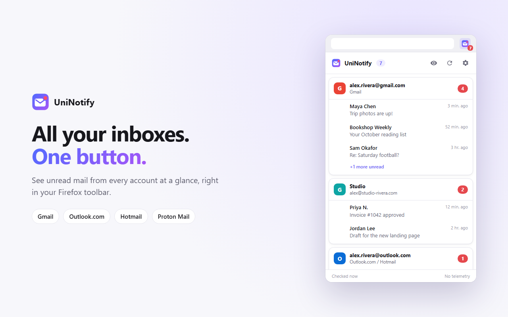
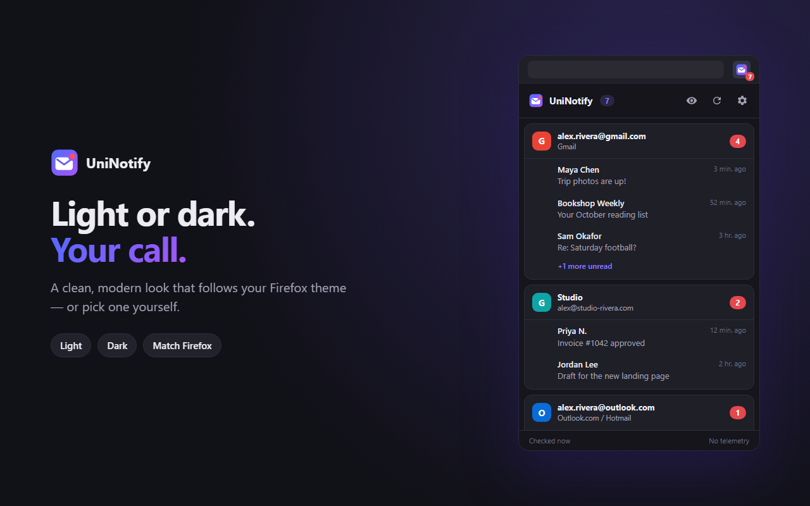
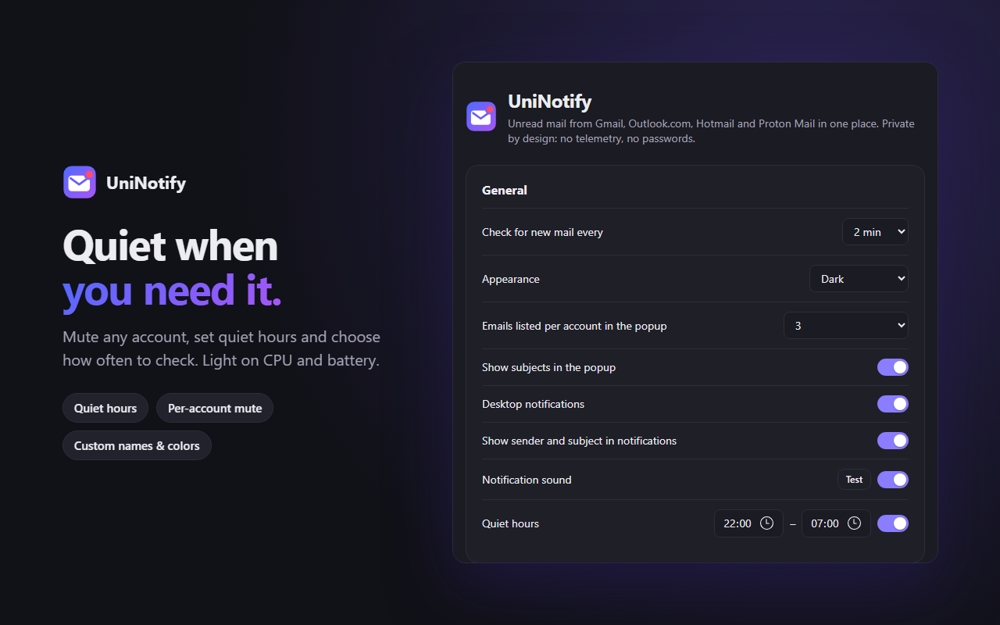

# UniNotify

**All your inboxes. One button.**

Unread mail from Gmail, Outlook.com, Hotmail and Proton Mail, right in your Firefox toolbar.
Private by design: no telemetry, no passwords, no servers.

  

## What it does

- **One badge for every inbox.** The toolbar icon shows how many unread emails you have across all your accounts.
- **Peek without switching tabs.** Click the icon to see who wrote and what about, for every account.
- **Jump straight in.** Click an account to open its inbox, or a message to open that email. If the webmail is already open in a tab, UniNotify switches to it instead of opening another one.
- **Desktop notifications** with an optional soft chime when new mail arrives.
- **Several accounts per service.** For example, a personal and a work Gmail.
- **Make it yours.** Give each account a nickname and a color, mute the noisy ones, or hide them entirely.
- **Quiet hours.** Silence notifications at night or whenever you choose.
- **Light and dark themes** that follow Firefox, or pick one yourself.
- **Light on your computer.** UniNotify sleeps between checks and wakes up only for a few seconds to look for new mail.
- Available in **English** and **Portuguese (Brazil)**.

## Supported services

| Service | Status |
|---|---|
| Gmail (including Google Workspace accounts) | ✅ |
| Outlook.com, Hotmail, Live and MSN | ✅ |
| Proton Mail | ✅ |

## Your privacy

UniNotify was built for people who care about where their data goes.

- **No telemetry, analytics or tracking.** None. UniNotify has no servers and never "phones home".
- **No passwords.** For Gmail and Proton Mail, UniNotify uses the session you already have in Firefox. For Outlook, you connect through Microsoft's own sign-in page. UniNotify never sees, asks for or stores your password.
- **Talks only to your mail providers.** Gmail mail goes to Google, Outlook mail to Microsoft, Proton mail to Proton. This is enforced by the extension's security policy, so it *can't* contact any other website.
- **Only asks for what you use.** UniNotify gets access to a service only after you turn that service on, and gives the access back when you turn it off.
- **Your mail stays in memory.** Subjects and senders are kept only in memory and are cleared when Firefox closes. They are never written to disk and never synced.
- **Outlook through Microsoft's official API**, with the most limited mail permission Microsoft offers: no message bodies and no attachments. Its sign-in tokens stay on your computer and are deleted when you disconnect.
- **Proton stays encrypted.** For Proton Mail, UniNotify reads only the unread count, sender and subject. Message bodies are never requested.
- **Open source.** Every line of code is in this repository for anyone to review.

Read the full [Privacy Policy](PRIVACY.md).

## Sync across your computers

If you use a Firefox Account, your **UniNotify preferences sync automatically**: check interval, theme, notifications, quiet hours, and the nicknames, colors and mute choices for your accounts.

Your mail itself is never synced. On a new computer, just sign in to your webmail in Firefox and UniNotify picks it up.

## Install

**Firefox Add-ons:** coming soon.

**Manual install (for testing):**
1. Download the latest `.zip` from the [Releases](https://github.com/Antxj/UniNotify/releases) page.
2. In Firefox, open `about:debugging#/runtime/this-firefox`.
3. Click **Load Temporary Add-on…** and select the downloaded file.

> Temporary add-ons are removed when Firefox restarts. The Firefox Add-ons version installs permanently and updates itself.

## Getting started

1. Click the UniNotify icon in the toolbar and choose **Add accounts**.
2. Turn on the services you use. Firefox will ask you to allow access to that service's website. This is the only permission UniNotify needs.
3. **Gmail and Proton Mail:** make sure you're signed in to that webmail in Firefox. That's it: your accounts show up automatically.
4. **Outlook.com / Hotmail:** click **Connect an Outlook account** and sign in with Microsoft. Repeat this for each Outlook account you want.

  
  

## FAQ

**An account says "Signed out". What do I do?**
Click **Sign in**, log in to that webmail in Firefox, and UniNotify will pick it up on the next check. For Outlook, choose **Reconnect** in the settings. UniNotify only works while you're signed in to your webmail in Firefox.

**Why does Outlook need a separate sign-in?**
Microsoft's current Outlook web app no longer lets other apps reuse its browser session. Connecting through Microsoft's official sign-in is the supported, secure way, and you can revoke it anytime at [account.live.com/consent/Manage](https://account.live.com/consent/Manage).

**Do I need to keep my webmail open in a tab?**
No. UniNotify checks in the background even when no mail tab is open.

**Does it work in private windows or containers?**
UniNotify uses the session from your regular Firefox window. Accounts signed in only inside a private window or a container tab won't be detected.

**Can it delete or send email?**
No. UniNotify only reads your unread count and the sender and subject of unread messages.

**Why does Firefox ask for "cookies" permission when I turn on Proton Mail?**
Proton identifies each signed-in session with a cookie. UniNotify reads only that cookie's *name* to know which session to ask about, and only for `mail.proton.me`. It never reads the cookie's value or any other site's cookies. When you have more than one Proton account, a tiny helper on Proton's own pages tells UniNotify which account is which, so messages open in the right one.

**Something isn't working.**
Webmail services sometimes change how they work. Please [open an issue](https://github.com/Antxj/UniNotify/issues) and describe what you see. Never include passwords or email contents.

## License

UniNotify is free and open-source software under the [Mozilla Public License 2.0](LICENSE).

Gmail, Outlook, Hotmail and Proton Mail are trademarks of their respective owners. UniNotify is an independent project and is not affiliated with or endorsed by Google, Microsoft or Proton.
